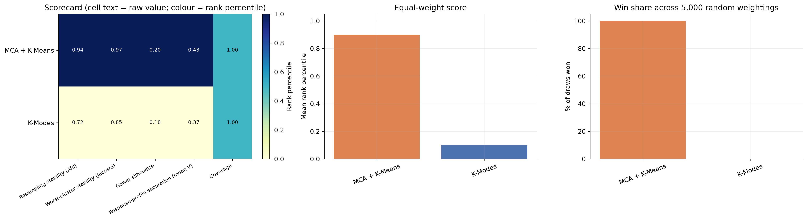
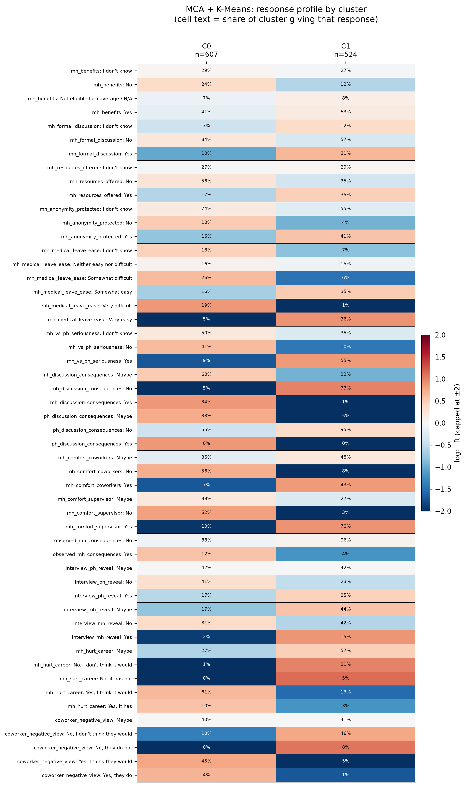
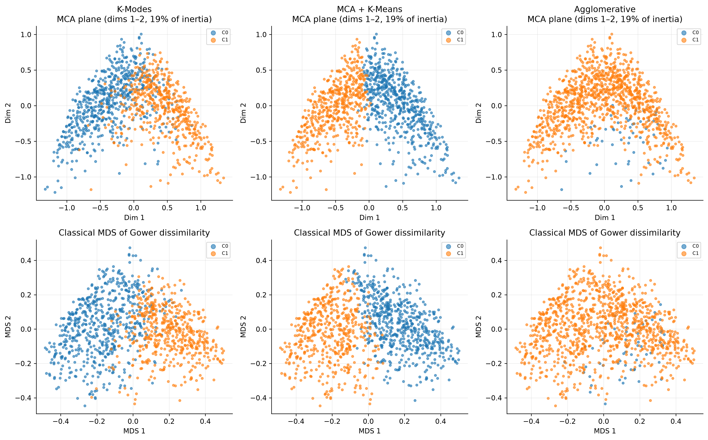

# Workplace Support and Disclosure Climate in Tech: Clustering the OSMI 2016 Survey

An exploratory, ethics-aware clustering study of the **OSMI 2016 Mental Health in Tech Survey**. It asks whether tech employees' answers about employer support, psychological safety and disclosure climate contain **defensible, aggregate response patterns**, and how robust any such patterns are.

The project is exploratory and descriptive. It does **not** diagnose mental-health conditions, infer causes, rank individuals, or support employee-level decisions. The source is a historical, voluntary, self-reported survey.

---

## Headline findings

| | |
|---|---|
| **Cohort** | 1,131 non-self-employed respondents working for a tech company or in a tech role (of 1,433 records) |
| **Clustering inputs** | 15 workplace-climate items in three equally weighted domains; no diagnosis, treatment, demographic or geographic variable is used |
| **Recommended model** | **MCA (14 dimensions) + K-Means, k = 2** (clusters of 607 and 524 respondents) |
| **Stability** | Mean resampling ARI 0.94; least stable cluster mean Jaccard 0.97 |
| **Separation** | **Weak.** Gower silhouette 0.20 (no substantial structure) |
| **What the two clusters are** | One dominant gradient. **C0:** not comfortable discussing mental health with supervisor or coworkers, and expects career harm and negative views from coworkers. **C1:** comfortable with their supervisor and expects no consequences from raising mental health |
| **Who is in them** | Age is unrelated to cluster; gender and remote-work frequency show small effects (Cramér's V ≈ 0.10 and 0.16); company size, tech-company status and country are negligible |

**How to read this honestly.** The recommended model is clearly the most *stable* option, but the evidence for *distinct types* of workplace is weak:

- The silhouette is low for every method and is practically tied between the two eligible families; the winner's advantage comes from stability and response-profile separation, not from better-separated clusters.
- The two eligible methods agree only moderately on who belongs where (K-Modes vs MCA + K-Means: ARI 0.47, NMI 0.40), so the k = 2 split is partly method-dependent.
- Average-linkage hierarchical clustering produced only degenerate cuts (a cluster of 2 respondents at every k), and HDBSCAN found no dense groups (no configuration clustered more than 36% of respondents).

The result is best read as **a single dominant axis of perceived psychological safety and support, summarised into two groups**, not as two natural categories of employer or employee. A negative or weak result is a legitimate outcome of this design and is reported as such.

---

## Data

| | |
|---|---|
| **Dataset** | OSMI Mental Health in Tech Survey, 2016 |
| **Creator** | Open Sourcing Mental Illness (OSMI) |
| **Source** | <https://www.kaggle.com/datasets/osmi/mental-health-in-tech-2016> |
| **Licence** | [Creative Commons Attribution-ShareAlike 4.0 International (CC BY-SA 4.0)](https://creativecommons.org/licenses/by-sa/4.0/) |
| **Size** | 1,433 respondent records × 63 variables |
| **Local file** | `data/raw/mental-heath-in-tech-2016_20161114.csv` (the file name, including its spelling, is as distributed by the source) |

The raw file is an unmodified copy. Everything in `data/interim/`, `data/processed/` and the tables in `reports/results/` is an **adaptation** of that data and is therefore shared under the same licence. See [`DATA_LICENSE.md`](DATA_LICENSE.md) for attribution, the changes made, and how the licences apply to this repository.

**Suggested citation of the source data:** Open Sourcing Mental Illness (2016). *OSMI Mental Health in Tech Survey 2016* [Data set]. Kaggle. <https://www.kaggle.com/datasets/osmi/mental-health-in-tech-2016>. Licensed under CC BY-SA 4.0.

---

## Repository structure

```
.
├── README.md
├── DATA_LICENSE.md                 # attribution and CC BY-SA 4.0 notice for the data and derivatives
├── LICENSE                         # code licence (MIT)
├── pyproject.toml / uv.lock        # environment (Python >= 3.13, managed with uv)
├── data/
│   ├── raw/                        # original survey CSV (unmodified)
│   ├── interim/                    # same observations, standardised column names only
│   └── processed/                  # cleaned cohort and model-ready representations
├── notebooks/
│   ├── 01_data_understanding.ipynb
│   ├── 02_data_preparation.ipynb
│   ├── 03_data_modelling.ipynb
│   └── 04_model_evaluation.ipynb
└── reports/
    ├── figures/{data_understanding,data_preparation,data_modelling,model_evaluation}/
    └── results/{data_modelling,model_evaluation}/
```

## Notebook pipeline

Run the notebooks **in order**. Each reads the artefacts written by the previous one.

| # | Notebook | Purpose | Main outputs |
|---|---|---|---|
| 1 | `01_data_understanding` | Schema, data quality, missingness and survey routing, cohort rule, feature scope, and the **modelling specification** that later notebooks follow | `data/interim/osmi_2016_renamed_interim.csv` |
| 2 | `02_data_preparation` | Reconstructs the eligible cohort, validates the 15 features, builds the three model representations and audits them | `data/processed/*` (see below) |
| 3 | `03_data_modelling` | Fits K-Modes, MCA + K-Means, average-linkage agglomerative clustering and HDBSCAN; selects one *representative configuration per family* under admissibility rules | `reports/results/data_modelling/*` |
| 4 | `04_model_evaluation` | Profiles every candidate, evaluates them on common footing (stability, separation, agreement), applies decision gates, recommends a model | `reports/results/model_evaluation/*` |

Prepared artefacts in `data/processed/`:

| File | Used by |
|---|---|
| `osmi_2016_kmodes_input.csv` | K-Modes (categorical labels) |
| `osmi_2016_mca_indicator_matrix.csv` | MCA + K-Means (complete disjunctive matrix) |
| `osmi_2016_gower_typed_input.csv`, `osmi_2016_gower_dissimilarity.npy` | Agglomerative and HDBSCAN (precomputed domain-balanced Gower dissimilarity) |
| `osmi_2016_model_row_mapping.csv` | Row lineage: `model_row_index` ↔ `source_row_position` |
| `osmi_2016_cleaned_respondents.csv` | Descriptive profiling only (never a model input) |
| `osmi_2016_primary_cohort.csv`, `osmi_2016_feature_metadata.csv`, `osmi_2016_preparation_metadata.json` | Cohort, feature schema and run metadata |
| `osmi_2016_cramers_v_matrix.csv`, `osmi_2016_cramers_v_pairs.csv` | Pairwise feature-association audit (descriptive) |

---

## Method

### Cohort
1,433 records → 287 self-employed respondents removed → 1,146 non-self-employed → 15 who report neither a tech employer nor a tech role removed → **1,131 respondents** (883 at a tech company, plus 248 in a tech role at a non-tech employer). The rule is fixed in Notebook 1 before modelling.

### Features: 15 predeclared items, three equally weighted domains
| Domain | Items |
|---|---|
| **Employer support** (6) | `mh_benefits`, `mh_formal_discussion`, `mh_resources_offered`, `mh_anonymity_protected`, `mh_medical_leave_ease`, `mh_vs_ph_seriousness` |
| **Psychological safety** (5) | `mh_discussion_consequences`, `ph_discussion_consequences`, `mh_comfort_coworkers`, `mh_comfort_supervisor`, `observed_mh_consequences` |
| **Disclosure and career climate** (4) | `interview_ph_reveal`, `interview_mh_reveal`, `mh_hurt_career`, `coworker_negative_view` |

The features were not selected using results. Personal diagnosis and history, treatment, condition descriptions, demographics, country/state and free text are **excluded from clustering**.

### Representations and dissimilarity
- **K-Modes:** original categorical responses, simple-matching dissimilarity; the ordinal leave-difficulty item is deliberately treated as nominal.
- **MCA + K-Means:** complete disjunctive (indicator) matrix; row principal coordinates, retaining dimensions with eigenvalue above 1/Q (14 dimensions; 59.6% of raw and 87.3% of Greenacre-adjusted inertia).
- **Gower dissimilarity (agglomerative, HDBSCAN):** nominal items use 0/1 mismatch; `mh_medical_leave_ease` uses normalised rank distance across its five substantive responses, with "I don't know" kept as a separate unordered response. Distances are averaged within each domain, then the three domains receive equal weight.
- Ward linkage is **not** used (it assumes Euclidean geometry, which a Gower matrix does not guarantee).

### Candidate selection within each family (Notebook 3)
Each family's configuration is chosen with its own diagnostics, after admissibility screens (at least two clusters, smallest cluster at least 5% of respondents, stability floor; HDBSCAN additionally needs at least 50% coverage and DBCV above zero). Highlights:

- **K-Modes:** best-of-5 Huang starts per fit; repeated-run stability, 80% subsample resampling stability, and cost elbow.
- **MCA + K-Means:** MCA-space silhouette, Davies–Bouldin, Calinski–Harabasz and repeated-start stability.
- **Agglomerative:** average linkage first; complete and weighted linkage only as flagged sensitivity fallbacks, because average linkage chains on sparse categorical data.
- **HDBSCAN:** 40-configuration grid (`min_cluster_size`, `min_samples`, EOM and leaf), ranked by DBCV with noise share, persistence and membership strength reported.

### Evaluation and recommendation (Notebook 4)
No ground-truth labels exist, so a good partition must be stable, non-degenerate and interpretable.

1. **Gates, fixed in advance.** A family must have a declared representative; smallest cluster at least 5%; at least 80% of respondents clustered; mean resampling ARI at least 0.60; worst-cluster mean Jaccard at least 0.60.
2. **Common-footing criteria** computed identically for every family: resampling stability (30 shared 80% subsamples, each family refitted from scratch), worst-cluster Jaccard stability, Gower silhouette, response-profile separation (bias-corrected Cramér's V) and coverage.
3. **Ranking.** Equal-weight rank percentiles, with differences below a declared material margin treated as ties; raw margins over the runner-up are reported; weights are then randomised 5,000 times. When the winner is never outranked, the weight test is uninformative and the report says so.
4. **Honest reading.** Silhouette bands, cross-family agreement among *eligible* families only, and descriptive (post-hoc) contextual profiling.

---

## Results (reference run)

| Family | Representative | Clusters | Smallest | Resampling ARI | Worst-cluster Jaccard | Gower silhouette | Gates |
|---|---|---|---|---|---|---|---|
| **MCA + K-Means** | k = 2 | 607 / 524 | 524 | **0.94** | **0.97** | **0.20** | 5/5 |
| K-Modes | k = 2 | 621 / 510 | 510 | 0.68 | 0.83 | 0.18 | 5/5 |
| Agglomerative | weighted linkage (fallback), k = 2 | 1,074 / 57 | 57 | 0.10 | 0.10 | 0.11 | 3/5 |
| HDBSCAN | none qualified | n/a | n/a | n/a | n/a | n/a | 0/5 |

MCA + K-Means has a material advantage over K-Modes on resampling stability (0.94 vs 0.68), worst-cluster stability (0.97 vs 0.83) and response-profile separation (0.43 vs 0.37), and is practically tied on Gower silhouette and coverage.







The full set of tables and figures is in `reports/results/` and `reports/figures/`. The machine-readable recommendation is `reports/results/model_evaluation/osmi_2016_model_recommendation.json`.

### Reproducibility notes
- Data preparation, the Gower matrix and the final partitions of all three fitted families were reproduced **exactly** (identical cluster assignments) in an independent re-run from the raw CSV, including on a different Python minor version.
- Resampling-based statistics (notably K-Modes stability) can shift by a few hundredths across platforms and package versions. The conclusions do not change, and every threshold and seed is declared at the top of the notebooks.

---

## Reproducing the analysis

Requires **Python 3.13 or newer** (see `.python-version` and `pyproject.toml`). With [uv](https://docs.astral.sh/uv/):

```bash
uv sync                      # creates .venv and installs the locked dependencies
uv run jupyter lab           # then open the notebooks from the notebooks/ directory
```

Without uv:

```bash
python -m venv .venv
source .venv/bin/activate            # Windows PowerShell: .venv\Scripts\Activate.ps1
python -m pip install hdbscan kmodes matplotlib numpy pandas scipy scikit-learn seaborn jupyter ipykernel
jupyter lab
```

Run notebooks `01` → `04` in order. The notebooks resolve paths from the repository root whether launched from the root or from `notebooks/`. Notebooks 3 and 4 are the slowest steps (repeated K-Modes starts, the HDBSCAN grid and subsample refits). All randomness uses fixed seeds (`RANDOM_STATE = 42`).

### Outputs
| Folder | Contents |
|---|---|
| `reports/results/data_modelling/` | Grid search of all candidates, per-family comparison, candidate cluster labels, selection handoff, run metadata |
| `reports/results/model_evaluation/` | Scorecard, winner margins, resampling stability, cross-family agreement, item association, long-format cluster profiles, distinctive responses, contextual profile, recommended assignments, recommendation JSON |

---

## Limitations and responsible use

- **Self-selected 2016 sample.** Respondents opted into a mental-health-themed survey, largely from the tech sector and the United States. Cluster sizes are not prevalence estimates, and workplace conditions have changed since 2016.
- **Weak separation.** Fifteen mostly three- or four-option items produce many tied responses and low silhouettes by construction. Clusters are summaries of overlapping response patterns, not natural types.
- **Method dependence.** The eligible methods agree only moderately on membership.
- **Coding choices matter.** The treatment of "I don't know" and "not applicable" responses in Notebook 2 is the most influential preparation decision for categorical methods and should be stress-tested in follow-up work.
- **Descriptive context only.** Demographic and contextual variables are joined after clustering for description; their p-values are descriptive and optimistic because the clusters were built on the same respondents.
- **No individual use.** Cluster numbers are arbitrary labels, not ranks. Do not use individual assignments for screening, diagnosis, discipline, hiring, promotion or any other employment decision.

## Licence

- **Code** (notebooks, configuration): MIT, see [`LICENSE`](LICENSE).
- **Data and derived data** (`data/`, `reports/results/`, and figures that display them): CC BY-SA 4.0, see [`DATA_LICENSE.md`](DATA_LICENSE.md).

## References

- Open Sourcing Mental Illness (2016). *OSMI Mental Health in Tech Survey 2016.* <https://www.kaggle.com/datasets/osmi/mental-health-in-tech-2016>
- Hennig, C. & Liao, T. F. (2013). How to find an appropriate clustering for mixed-type variables with application to socio-economic stratification. *Journal of the Royal Statistical Society: Series C*, 62(3), 309–369.
- Hennig, C. (2007). Cluster-wise assessment of cluster stability. *Computational Statistics & Data Analysis*, 52(1), 258–271.
- Huang, Z. (1998). Extensions to the k-means algorithm for clustering large data sets with categorical values. *Data Mining and Knowledge Discovery*, 2, 283–304.
- Greenacre, M. (2017). *Correspondence Analysis in Practice* (3rd ed.). Chapman & Hall/CRC.
- Gower, J. C. (1971). A general coefficient of similarity and some of its properties. *Biometrics*, 27(4), 857–871.
- Campello, R. J. G. B., Moulavi, D. & Sander, J. (2013). Density-based clustering based on hierarchical density estimates. *PAKDD 2013*.
- Moulavi, D., Jaskowiak, P. A., Campello, R. J. G. B., Zimek, A. & Sander, J. (2014). Density-based clustering validation. *SDM 2014*.
- Bergsma, W. (2013). A bias-correction for Cramér's V and Tschuprow's T. *Journal of the Korean Statistical Society*, 42(3), 323–328.
- Kaufman, L. & Rousseeuw, P. J. (1990). *Finding Groups in Data: An Introduction to Cluster Analysis.* Wiley.
- Rousseeuw, P. J. (1987). Silhouettes: a graphical aid to the interpretation and validation of cluster analysis. *Journal of Computational and Applied Mathematics*, 20, 53–65.
